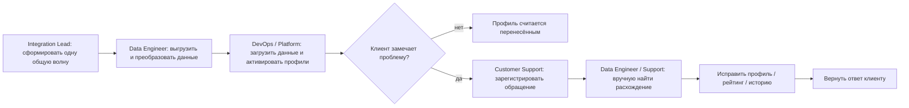
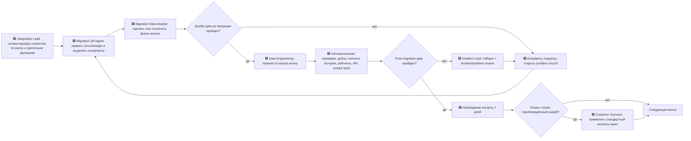
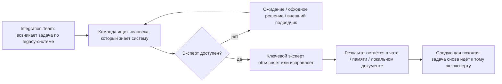
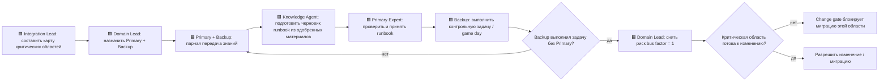

# Практическая работа №3 — Процессы под гипотезы

**Курс:** Управление информационными технологиями на предприятии  
**Семестр:** осень/зима 2026  
**Объект исследования:** ATI.SU  
**Опирается на:** гипотезы №1, №2 и №3, взятые в работу в ПР2  
**Финансовая база:** 1 475 795 000 ₽ выручки за 2025 год

---

## Краткая версия паспорта проекта

1. **Бизнес:** ATI.SU — SaaS / цифровая B2B-платформа для транспортной логистики.
2. **Масштаб:** выручка ООО ИА «АВТОТРАНСИНФО» — **1 475 795 000 ₽ за 2025 год**; 1% выручки ≈ **14,8 млн ₽**.
3. **Направления:** лицензии и платные функции ATI.SU, «Площадки ATI.SU», API и аналитика; после эпизода 1 рассматривается коммерческий продукт на данных.
4. **ИТ-функция:** крупная собственная продуктовая разработка; после эпизода 1 диагноз **«Партнёр» сохраняется, зона состояния ИТ — 🟡** из-за разрыва в M&A integration capability.
5. **Ограничения:** внутренние времена процессов, стоимость труда и объём миграционных дефектов публично не раскрыты; неизвестные значения либо измеряются до изменения, либо явно отмечаются как допущения.

---

# 1. Выбор процессов и связь с ПР2

В ПР2 в работу были приняты три гипотезы:

- **Гипотеза №1:** безопасная волновая миграция клиентов;
- **Гипотеза №3:** recovery-пакет для пострадавших платных клиентов;
- **Гипотеза №2:** удержание критических сотрудников и передача знаний.

Для ПР3 выбраны два процесса:

| Процесс | Гипотезы ПР2 | Через какой шаг реализуется гипотеза |
|---|---|---|
| **Процесс A. Миграция и восстановление клиента** | №1, №3 | №1 реализуется через предварительную сверку, миграцию малыми волнами, quality gate и rollback; №3 — через отдельную ветку recovery после подтверждённого клиентского ущерба |
| **Процесс B. Снижение зависимости от ключевого эксперта** | №2 | через knowledge map, назначение backup, передачу знаний, проверку backup на практической задаче и запрет критического изменения при `bus factor = 1` |

Процессы не добавлены «для полноты»: каждый обслуживает гипотезу, которую ПР2 явно взяла в работу.

---

# 2. Правило доказательности и замер до изменения

Внутренние telemetry/CRM/HR-данные ATI.SU в открытых источниках недоступны. Поэтому в этой работе:

- **факт** — то, что следует из ПР1, ПР2 или сценария;
- **замер** — значение, которое должно быть снято из внутренней системы до пилота;
- **целевое значение** — проектный порог нового процесса;
- **допущение** — число, необходимое для предварительной экономики, но не выданное за фактический baseline.

Пилот нового процесса **не начинается до фиксации baseline**. План съёма приведён в таблицах и отдельном CSV-файле.

---

# 3. Процесс A — миграция и восстановление клиента

## 3.1. Связь с гипотезами

Процесс обслуживает:

- **ПР2 №1:** автоматизированная сверка + малые волны + quality gate + rollback должны снизить migration-related churn;
- **ПР2 №3:** стандартизированный recovery-пакет должен снизить отток среди клиентов, которым миграция уже причинила ущерб.

Главная потеря исходного процесса — **дефект обнаруживается после воздействия на клиента**, поэтому время ожидания до обнаружения и последующий rework важнее чистого времени ETL.

---

## 3.2. Процесс A до изменения

### Таблица потерь — процесс A до изменения

| Шаг | Роль | Время работы | Время ожидания | Потеря | Как снять baseline до изменения |
|---|---|---:|---:|---|---|
| Формирование общей волны | Integration Lead / Product Owner | **не измерено** | **не измерено** | размер волны не ограничен риском; нет клиентской сегментации | release/migration tracker за последнюю неудачную волну; период — весь цикл подготовки; владелец — Integration Lead |
| Выгрузка и преобразование | Data Engineer | **не измерено** | **не измерено** | ошибки сопоставления обнаруживаются поздно | migration/ETL logs по последней волне; владелец — Data Engineering |
| Загрузка и активация | DevOps / Platform team | **не измерено** | **не измерено** | нет формального quality gate до воздействия на клиента | deploy/migration logs; период — окно миграции; владелец — Platform/DevOps |
| Обнаружение проблемы | Клиент + Customer Support | фактическая работа клиента не считается внутренней работой | **не измерено; ключевой baseline** | ожидание до жалобы: проблема уже влияет на работу и доверие клиента | `first_error_timestamp → first_support_ticket_timestamp`; период — последняя волна; владелец — Support Analytics |
| Регистрация и маршрутизация | Customer Support | **не измерено** | **не измерено** | очередь и повторное описание проблемы | support tracker; 30 дней после миграции; владелец — Head of Support |
| Диагностика и ручная коррекция | Support + Data Engineer | **не измерено; ключевой baseline** | **не измерено** | rework, переключение контекста, зависимость от эксперта | tickets + engineering tracker; 30 дней после миграции; владелец — Support + Data Engineering |
| Решение по компенсации | Account / Support lead | **не стандартизировано** | **не измерено** | разные клиенты получают разную реакцию; решение задерживается | CRM/support cases; 30 дней; владелец — Customer Success / Commercial |

### Baseline, который обязателен перед изменением

1. migration-related churn / потеря платной выручки по когорте;
2. доля мигрированных профилей с расхождениями;
3. доля дублей;
4. медиана и P90 времени `ошибка → обнаружение`;
5. медиана и P90 времени `ticket → исправление`;
6. число повторных обращений по одной миграционной причине;
7. стоимость ручного rework;
8. доля пострадавших платных клиентов, которым потребовалась компенсация.

**До появления этой выгрузки численный фактический эффект нового процесса не утверждается.**

---

## 3.3. Процесс A после изменения

Обозначение `🟦` — новый или существенно изменённый шаг.

### Изменения, потеря и гипотеза

| Изменение | Какую потерю убирает | Гипотеза ПР2 | Ожидаемое время работы | Ожидаемое ожидание |
|---|---|---|---:|---:|
| Сегментация по риску | одна ошибка больше не затрагивает всю базу | №1 | ≤ 30 мин на волну после настройки правил | согласование ≤ 4 ч |
| Agent pre-check source/target | дефекты выявляются до воздействия на клиента | №1 | целевой machine time ≤ 30 мин / 1 000 профилей | 0 |
| Human acceptance флагов | не отдаёт агенту необратимое решение об идентичности | №1 | **3 мин / flagged profile** — допущение | очередь ≤ 4 ч |
| Малая волна | ограничивает blast radius | №1 | зависит от фактического ETL baseline | окно ожидания планируется заранее |
| Post-migration quality gate | дефект не объявляется «успешной миграцией» | №1 | ≤ 60 мин на волну | 0–2 ч |
| Rollback | сокращает длительность клиентского ущерба | №1 | целевой RTO rollback ≤ 2 ч | 0 |
| 7-дневное наблюдение | ловит не мгновенные дефекты и churn-сигналы | №1 | автоматический мониторинг | **7 дней — осознанное ожидание** |
| Стандартный recovery-пакет | сокращает уход уже пострадавших клиентов | №3 | ≤ 10 мин на подтверждённый кейс | решение ≤ 1 рабочий день |

---

# 4. Процесс B — снижение зависимости от ключевого эксперта

## 4.1. Связь с гипотезой

Процесс обслуживает **ПР2 №2**: если убрать `bus factor = 1` по критическим областям, компания должна снизить rework, аварийную внешнюю поддержку и задержки интеграции.

Главная потеря исходного процесса — **ожидание единственного эксперта и повторное возникновение уже решённой проблемы**, потому что знание остаётся в голове или чатах.

---

## 4.2. Процесс B до изменения

### Таблица потерь — процесс B до изменения

| Шаг | Роль | Время работы | Время ожидания | Потеря | Как снять baseline |
|---|---|---:|---:|---|---|
| Поиск эксперта | Integration Team Lead | не измерено | **не измерено; ключевой baseline** | задача ждёт конкретного человека | issue tracker + календарь/назначение исполнителя; 60 дней; владелец — Integration Lead |
| Ожидание эксперта | Integration Team | 0 | **не измерено; ключевой baseline** | простой интеграционной задачи | `ticket_created → expert_first_response`; 60 дней; владелец — PMO/Integration |
| Диагностика / исправление | Key Expert | не измерено | не измерено | высокая стоимость senior-времени; контекст не тиражируется | engineering tracker/time log; 60 дней; владелец — Domain Lead |
| Передача знания | Key Expert | неформально | не измерено | knowledge loss, повторная работа | проверить наличие runbook/owner/backup; владелец — Domain Lead |
| Повторная похожая задача | Команда | не измерено | не измерено | rework и повторное ожидание | теги problem/incident в tracker; 90 дней; владелец — Problem Manager / Integration Lead |

### Baseline перед изменением

- число критических областей с `bus factor = 1`;
- медиана/P90 ожидания ключевого эксперта;
- часы rework по повторным проблемам;
- расходы на внешних специалистов для закрытия knowledge gap;
- доля критических областей с актуальным runbook и backup;
- доля задач, которые backup способен выполнить без primary expert.

---

## 4.3. Процесс B после изменения

### Изменения, потеря и гипотеза

| Изменение | Потеря | Гипотеза | Ожидаемое время работы | Ожидаемое ожидание |
|---|---|---|---:|---:|
| Critical knowledge map | неизвестно, где один носитель знания | №2 | ≤ 30 мин / область после инвентаризации | 0–1 день на подтверждение владельцем |
| Primary + Backup | зависимость от одного сотрудника | №2 | ≤ 15 мин назначения | ≤ 1 рабочий день |
| Парная передача знаний | repeated explanation / rework | №2 | **2 эксперта × 4 ч/нед × 8 недель** — плановая нагрузка | плановое ожидание отсутствует |
| Agent draft runbook | ручное оформление повторяющегося знания | №2 | machine time ≤ 15 мин / документ | 0 |
| Human acceptance runbook | риск неверной автоматической документации | №2 | **2 ч / критическая область** — допущение | ≤ 1 рабочий день |
| Backup game day | формальная документация без проверяемого навыка | №2 | 2 ч / область | ≤ 1 неделя на слот |
| Change gate | риск миграции при `bus factor = 1` | №2 | ≤ 15 мин решения | изменение может быть отложено до прохождения gate |

---

# 5. Затронутые практики ITIL 4

В работу включены только практики, которые реально меняются.

| Практика ITIL 4 | Почему попадает | Что меняется в этих процессах |
|---|---|---|
| **Change Enablement** | миграции и изменения legacy-систем должны проходить контролируемые gates | вместо big-bang — малые волны; обязательные pre/post gates, rollback criteria; change блокируется при `bus factor = 1` |
| **Incident Management** | миграционные дефекты и fraud уже воздействовали на клиента | выделяется migration incident path; критические дефекты ведут к rollback и отдельному клиентскому recovery |
| **Problem Management** | повторяющиеся дефекты mapping и повторные knowledge gaps нельзя лечить только тикетами | failed gate создаёт problem record; повторные причины устраняются до следующей волны |
| **Monitoring and Event Management** | раньше о части проблем узнавали от клиента | контроль дублей, полноты истории, API smoke tests и клиентских сигналов происходит до/сразу после волны |
| **Service Level Management** | клиенту важно не само выполнение ETL, а сохранение рабочих функций | вводятся quality/SLO criteria: полнота данных, отсутствие дублей, rollback ≤ 2 ч, recovery decision ≤ 1 рабочего дня |
| **Service Request Management** | восстановление рейтингов/истории и компенсация должны быть стандартным потоком | обращения migration-recovery получают отдельный тип запроса, правила маршрутизации и критерии компенсации |
| **Knowledge Management** | гипотеза №2 напрямую про потерю критического знания | knowledge map, runbook, backup и практическая проверка становятся обязательным результатом |
| **Workforce and Talent Management** | критические сотрудники получают предложения рынка | ключевые эксперты идентифицируются, удерживаются на период передачи знаний, роли в целевой структуре фиксируются |

**Supplier Management не включён:** конкретный внешний поставщик, удерживающий критический шаг этих процессов, в исходных данных не установлен.

---

# 6. DevOps / DORA

Гипотезы №1, №2 и №3 **не направлены на увеличение частоты релизов или сокращение lead time разработки продукта**. Их узкое место — качество миграции, клиентский churn и зависимость от критических экспертов.

Поэтому четыре DORA-метрики не используются как целевые показатели ПР3 и не подменяются отраслевым benchmark. Внутренние baseline deployment frequency, lead time for changes, change failure rate и time to restore service публично не раскрыты.

Если автоматизация migration pipeline потребует изменений продукта, DORA остаётся **guardrail**, а фактические значения должны быть сняты из CI/CD и incident telemetry до пилота.

---

# 7. Место агента

Используется ограниченный **Integration QA & Knowledge Agent**. Это не автономный исполнитель миграции и не лицо, принимающее юридически значимые решения.

## 7.1. Какие шаги уходят агенту

В процессе A:

- сравнение source/target записей;
- проверка полноты рейтинга/истории по формальным правилам;
- поиск дублей и аномалий;
- подготовка списка конфликтов;
- сбор evidence для quality gate;
- черновик migration report.

В процессе B:

- подготовка черновика runbook из **одобренных** записей knowledge-transfer сессий;
- поиск противоречий и пропущенных разделов;
- генерация checklist для backup game day.

## 7.2. Что агент видит и чем действует

Агенту разрешено:

- read-only доступ к техническому source/target snapshot;
- внутренние идентификаторы и контрольные суммы;
- структурные поля, необходимые для проверки полноты;
- обезличенные/минимизированные данные везде, где личные данные не нужны для проверки;
- одобренные архитектурные документы и transcripts knowledge-transfer;
- создание тикета, отчёта и черновика runbook.

Агент **не получает** право:

- самостоятельно объединять/удалять production-профили;
- менять рейтинг;
- подтверждать личность перевозчика;
- принимать fraud-решение;
- назначать компенсацию;
- определять допустимость использования данных по лебедю №55;
- выполнять production rollback без человека.

## 7.3. Кто принимает результат и сколько стоит приёмка

### Процесс A

Принимает результат **Migration Data Analyst**, а спорные случаи — владелец данных/доменный эксперт.

Для предварительной экономики используются **допущения**, а не выданные за факт значения:

- размер пилотной волны — **5 000 профилей**;
- агент флагирует **8%** профилей;
- первичная проверка — **3 мин / flag**;
- контрольная human-sample — **1%** волны по **5 мин**;
- loaded cost внутреннего специалиста — **2 000 ₽/ч**;
- agent/run cost — **10 000 ₽/волна**.

Расчёт:

- flagged profiles: `5 000 × 0.08 = 400`;
- human review: `400 × 3 мин = 20.0 ч`;
- контрольная выборка: `5 000 × 0.01 × 5 мин = 4.17 ч`;
- стоимость human acceptance: `(20.0 + 4.17) × 2 000 = 48 333 ₽/волна`;
- вместе с agent/run cost: **≈ 58 333 ₽/волна**;
- для 6 пилотных волн: **≈ 350 000 ₽**.

Эта стоимость **вычитается из эффекта**, а не игнорируется.

### Процесс B

Черновик runbook принимает **Primary Expert**, а практическую достаточность знания подтверждает **Backup** выполнением контрольной задачи. Итог принимает **Domain Lead**.

Плановая стоимость одной критической области при допущении 2 000 ₽/ч:

- передача знаний: `2 эксперта × 4 ч/нед × 8 недель = 64 ч`;
- приёмка runbook: `2 ч`;
- agent/run cost: `2 000 ₽`;
- итого: **≈ 134 000 ₽ на область**.

## 7.4. Что не отдаётся агенту

Не передаются:

- решения с правовыми последствиями;
- окончательная идентификация клиента/перевозчика;
- решение «fraud / не fraud»;
- права на использование данных и consent mapping;
- решение об отключении legacy-системы;
- финальный change gate;
- финальная компенсация клиенту;
- действия, где ошибка может долго оставаться незаметной.

Причина: цена ложноположительного или ложноотрицательного решения выше экономии на человеческой проверке.

---

# 8. Расчёт эффекта

## 8.1. Процесс A — миграция и recovery

ПР2 задала для гипотезы №1 ожидаемый эффект **0,8–1,2% годовой выручки**:

- 0,8% = **11.81 млн ₽**;
- 1,2% = **17.71 млн ₽**.

Чтобы не задвоить эффект №1 и №3, в консервативном расчёте **не добавляется** ожидаемая сохранённая выручка recovery-пакета. Вместо этого его стоимость включается как расход.

Проектный предел бюджета recovery-пакета — **0,15% выручки**:

- 0,15% = **2.21 млн ₽** — допущение/guardrail.

Цена агента и приёмки для шести пилотных волн:

- **≈ 350 000 млн ₽**.

### Консервативный net effect

`Net = сохранённая выручка H1 − recovery budget cap − agent/acceptance cost`

- нижняя граница: `11.81 − 2.21 − 0.35 ≈ 9.24 млн ₽`;
- верхняя граница: `17.71 − 2.21 − 0.35 ≈ 15.15 млн ₽`.

Относительно выручки:

- **≈ 0.63–1.03%**.

Это остаётся **в отраслевом коридоре 0,5–2% для одного улучшения на выручку**.

**Важно:** это плановая модель на допущениях ПР2 и ПР3. После baseline/pilot она должна быть пересчитана по фактическим migration-related churn и стоимости recovery.

---

## 8.2. Процесс B — knowledge retention

ПР2 задала ожидаемую экономию **4–6% статьи затрат «integration/rework/external support»**.

Фактический размер статьи пока неизвестен, поэтому рублёвую экономию нельзя честно назвать.

Для одной критической области программа передачи знаний стоит по модели **≈ 134 000 ₽**.

Точка безубыточности:

- при эффекте 4% статья затрат должна быть больше **≈ 3.35 млн ₽ на область**;
- при эффекте 6% — больше **≈ 2.23 млн ₽ на область**.

Следовательно, программа применяется в первую очередь к областям, где стоимость knowledge loss и rework выше этого порога либо где клиентский/операционный риск критичен независимо от прямой экономии.

Целевой эффект **4–6% статьи** находится внутри отраслевого коридора **2–10% конкретной статьи затрат**.

---

# 9. Trade-off

## Процесс A

Улучшение качества достигается ценой скорости консолидации.

Проектный пилот: **6 волн по 2 недели = 12 недель**. По сравнению с одной массовой миграцией это добавляет примерно **10 недель параллельного существования двух контуров** после первой волны.

Цена компромисса:

- дольше сохраняются дублирующие системы;
- позже реализуется часть синергии;
- остаётся дополнительный run-cost параллельной эксплуатации.

Формула денежной цены:

`trade-off cost = 10 недель × недельный run-cost параллельного контура`.

Сам run-cost должен быть снят финансовой инвентаризацией и не выдумывается.

## Процесс B

Knowledge transfer уменьшает доступность senior-специалистов для feature delivery.

На одну критическую область:

- **64 expert-hours** за 8 недель;
- это **8 expert-hours в неделю** на двух специалистов;
- при стандартных 80 доступных часах двух FTE в неделю — около **10% их совокупной ёмкости** на период передачи знаний.

Это устойчивое ухудшение скорости feature work, а не только «переходная просадка». Оно принимается осознанно, потому что альтернатива — остановка интеграции или дорогой rework при уходе единственного эксперта.

---

# 10. Метрики, которые перейдут в ПР4

Эти показатели непосредственно порождаются процессами ПР3.

| Бизнес-результат | Показатель процесса | Системный сигнал / точка съёма |
|---|---|---|
| Сохранённая выручка | migration-related churn / retained revenue | billing + cohort tag конкретной migration wave |
| Сохранение доверия | доля профилей без расхождений после миграции | source-target reconciliation report |
| Снижение клиентского ущерба | P90 `дефект → исправление` | support + incident timestamps |
| Управляемая миграция | доля волн, прошедших gate без rollback | migration pipeline / change records |
| Снижение rework | часы повторных исправлений | engineering/problem tracker |
| Снижение knowledge risk | число critical areas с `bus factor = 1` | knowledge map |
| Проверенная передача знания | доля backup, прошедших game day | knowledge/change records |

---

# 11. Реестр новых допущений ПР3

| Допущение | Значение | Уверенность | Зачем нужно | Кто/что проверит |
|---|---:|---|---|---|
| Размер пилотной волны | 5 000 профилей | низкая | расчёт цены agent acceptance | Integration Lead по фактическому migration capacity |
| Доля флагов агента | 8% | низкая | оценка human review | первая baseline-wave |
| Время первичной приёмки | 3 мин/flag | низкая | цена agent acceptance | time tracking Migration Data Analyst |
| Контрольная human-sample | 1% по 5 мин | средняя | защита от ошибок агента | Migration Data Owner |
| Loaded labor rate | 2 000 ₽/ч | низкая | перевод трудозатрат в ₽ | Finance/HR controlling |
| Agent/run cost | 10 000 ₽/волна | низкая | net effect | FinOps после выбора реализации |
| Число пилотных волн | 6 | средняя | экономика и 12-недельный план | Integration Steering Committee |
| Recovery budget cap | 0,15% выручки = 2.21 млн ₽ | низкая | не допустить, чтобы компенсация съела эффект | Commercial + Finance |
| Knowledge-transfer нагрузка | 2×4 ч/нед×8 недель | средняя | ресурсный план | Domain Leads |
| Human acceptance runbook | 2 ч/область | низкая | цена агента | Primary Expert |
| Фактический migration-related churn | неизвестно | — | несущая цифра H1 | Billing/cohort analysis до пилота |
| Run-cost параллельного контура | неизвестно | — | денежная цена trade-off | Finance + application portfolio |
| Размер integration/rework/support cost pool | неизвестно | — | рублёвый эффект H2 | Finance + Integration PMO |

---

# 12. План съёма baseline до пилота

| Метрика | Система / источник | Период | Владелец данных | Формула |
|---|---|---|---|---|
| Migration-related churn | billing + migration cohort | 90 дней до/60 дней после прошлой волны | Billing/Product Analytics | потерянная платная выручка когорты / платная выручка когорты до миграции |
| Доля дефектных профилей | source/target snapshots + support | последняя миграционная волна | Data Engineering | профили с подтверждённым mismatch / мигрированные профили |
| Time-to-detect | migration logs + support tracker | последняя волна | Support Analytics | first_ticket_ts − migration_complete_ts |
| Time-to-recover | support/incident tracker | 30 дней после волны | Support/Incident Lead | resolved_ts − first_ticket_ts |
| Rework hours | engineering/problem tracker | 60 дней | Integration PMO | часы задач, помеченных migration rework |
| Bus factor = 1 | knowledge map | снимок до пилота | Domain Leads | count(critical area with only one qualified expert) |
| Expert waiting time | issue tracker | 60 дней | Integration PMO | expert_first_response − task_created |
| External support/rework cost | finance + vendor invoices | 6 месяцев | Finance | сумма расходов по выбранной статье |
| Parallel run-cost | finance + application portfolio | месяц | Finance/IT asset owner | monthly run-cost legacy + target overlap |

---

# 13. Вывод

ПР3 перепроектирует два процесса, которые непосредственно обслуживают гипотезы, выбранные в ПР2:

1. **миграция и восстановление клиента** — гипотезы №1 и №3;
2. **снижение зависимости от ключевого эксперта** — гипотеза №2.

Основное изменение процесса A — перенос контроля **до воздействия на клиента**: pre-check, human acceptance, малые волны, quality gate, rollback и стандартный recovery.

Основное изменение процесса B — перевод знания из персональной зависимости в проверяемую организационную способность: Primary + Backup, runbook, game day и запрет критического изменения при `bus factor = 1`.

Агент используется только на повторяемой работе с проверяемым результатом; финальные решения остаются у человека, а стоимость приёмки включена в экономику.

Плановый net effect процесса A после стоимости recovery и agent acceptance составляет **≈ 0.63–1.03% выручки**, то есть остаётся внутри отраслевого коридора. Для процесса B эффект остаётся **4–6% конкретной статьи затрат**, но в рубли он переводится только после фактического baseline.

Главное ограничение ПР3: без внутренней выгрузки нельзя честно заменить плановые оценки фактическим эффектом. Поэтому до пилота должен быть выполнен baseline-план из раздела 12.

---

# 14. Источники и связь с предыдущими работами

1. [Практическая работа №1 — версия после эпизода 1](./practice_01_ati_su_episode1_revised_v2.md)
2. [Практическая работа №2 — гипотезы роста](./practice_02_ati_su.md)
3. Условия лебедей №37 и №55 — норматив игрового эпизода курса.
4. Отраслевой коридор ATI.SU — норматив курса.
5. Задание ПР3 и модель скоринга — материалы курса, предоставленные вместе с работой.
