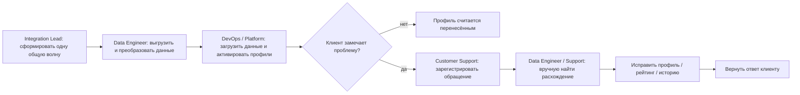
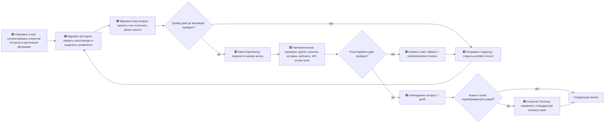
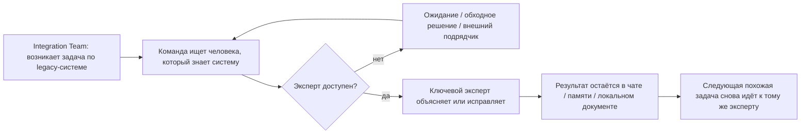
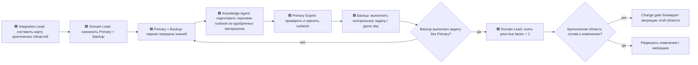

# Практическая работа №3 — Процессы под гипотезы

**Курс:** Управление информационными технологиями на предприятии  
**Семестр:** осень/зима 2026  
**Объект исследования:** ATI.SU  
**Выполнил:** Харитонов Глеб Сергеевич

**Редакция:** 19.11.2026, доработка по проверке ПР3 и назначенным лебедям №3 и №5 эпизода 2

**Опирается на:** гипотезы №1, №2 и №3, взятые в работу в ПР2  
**Финансовая база:** 1 475 795 000 ₽ выручки за 2025 год

---

## Краткая версия паспорта проекта

1. **Бизнес:** ATI.SU — SaaS / цифровая B2B-платформа для транспортной логистики.
2. **Масштаб:** выручка ООО ИА «АВТОТРАНСИНФО» — **1 475 795 000 ₽ за 2025 год**; 1% выручки ≈ **14,8 млн ₽**.
3. **Направления:** лицензии и платные функции ATI.SU, «Площадки ATI.SU», API и аналитика; после эпизода 1 рассматривается коммерческий продукт на данных.
4. **ИТ-функция:** крупная собственная продуктовая разработка; после эпизода 1 диагноз **«Партнёр» сохраняется, зона состояния ИТ — 🟡** из-за разрыва в M&A integration capability.
5. **Ограничения:** внутренние времена процессов, стоимость труда и объём миграционных дефектов публично не раскрыты; неизвестные значения либо измеряются до изменения, либо явно отмечаются как допущения.

---

# 1. Выбор процессов и связь с ПР2

В ПР2 в работу были приняты три гипотезы:

- **Гипотеза №1:** безопасная волновая миграция клиентов;
- **Гипотеза №3:** recovery-пакет для пострадавших платных клиентов;
- **Гипотеза №2:** удержание критических сотрудников и передача знаний.

Для ПР3 выбраны два процесса:

| Процесс | Гипотезы ПР2 | Через какой шаг реализуется гипотеза |
|---|---|---|
| **Процесс A. Миграция и восстановление клиента** | №1, №3 | №1 реализуется через предварительную сверку, миграцию малыми волнами, quality gate и rollback; №3 — через отдельную ветку recovery после подтверждённого клиентского ущерба |
| **Процесс B. Снижение зависимости от ключевого эксперта** | №2 | через knowledge map, назначение backup, передачу знаний, проверку backup на практической задаче и запрет критического изменения при `bus factor = 1` |

Процессы не добавлены «для полноты»: каждый обслуживает гипотезу, которую ПР2 явно взяла в работу.

---

# 2. Правило доказательности и замер до изменения

Внутренние telemetry/CRM/HR-данные ATI.SU в открытых источниках недоступны. Поэтому в этой работе:

- **факт** — то, что следует из ПР1, ПР2 или сценария;
- **замер** — значение, которое должно быть снято из внутренней системы до пилота;
- **целевое значение** — проектный порог нового процесса;
- **допущение** — число, необходимое для предварительной экономики, но не выданное за фактический baseline.

Пилот нового процесса **не начинается до фиксации baseline**. План съёма приведён в таблицах и отдельном CSV-файле.

---

# 3. Процесс A — миграция и восстановление клиента

## 3.1. Связь с гипотезами

Процесс обслуживает:

- **ПР2 №1:** автоматизированная сверка + малые волны + quality gate + rollback должны снизить migration-related churn;
- **ПР2 №3:** стандартизированный recovery-пакет должен снизить отток среди клиентов, которым миграция уже причинила ущерб.

Главная потеря исходного процесса — **дефект обнаруживается после воздействия на клиента**, поэтому время ожидания до обнаружения и последующий rework важнее чистого времени ETL.

---

## 3.2. Процесс A до изменения

### Таблица потерь — процесс A до изменения

| Шаг | Роль | Время работы | Время ожидания | Потеря | Как снять baseline до изменения |
|---|---|---:|---:|---|---|
| Формирование общей волны | Integration Lead / Product Owner | **не измерено** | **не измерено** | размер волны не ограничен риском; нет клиентской сегментации | release/migration tracker за последнюю неудачную волну; период — весь цикл подготовки; владелец — Integration Lead |
| Выгрузка и преобразование | Data Engineer | **не измерено** | **не измерено** | ошибки сопоставления обнаруживаются поздно | migration/ETL logs по последней волне; владелец — Data Engineering |
| Загрузка и активация | DevOps / Platform team | **не измерено** | **не измерено** | нет формального quality gate до воздействия на клиента | deploy/migration logs; период — окно миграции; владелец — Platform/DevOps |
| Обнаружение проблемы | Клиент + Customer Support | фактическая работа клиента не считается внутренней работой | **не измерено; ключевой baseline** | ожидание до жалобы: проблема уже влияет на работу и доверие клиента | `first_error_timestamp → first_support_ticket_timestamp`; период — последняя волна; владелец — Support Analytics |
| Регистрация и маршрутизация | Customer Support | **не измерено** | **не измерено** | очередь и повторное описание проблемы | support tracker; 30 дней после миграции; владелец — Head of Support |
| Диагностика и ручная коррекция | Support + Data Engineer | **не измерено; ключевой baseline** | **не измерено** | rework, переключение контекста, зависимость от эксперта | tickets + engineering tracker; 30 дней после миграции; владелец — Support + Data Engineering |
| Решение по компенсации | Account / Support lead | **не стандартизировано** | **не измерено** | разные клиенты получают разную реакцию; решение задерживается | CRM/support cases; 30 дней; владелец — Customer Success / Commercial |

### Baseline, который обязателен перед изменением

1. migration-related churn / потеря платной выручки по когорте;
2. доля мигрированных профилей с расхождениями;
3. доля дублей;
4. медиана и P90 времени `ошибка → обнаружение`;
5. медиана и P90 времени `ticket → исправление`;
6. число повторных обращений по одной миграционной причине;
7. стоимость ручного rework;
8. доля пострадавших платных клиентов, которым потребовалась компенсация.

**До появления этой выгрузки численный фактический эффект нового процесса не утверждается.**

### 3.2.1. Численная исходная точка для песочницы

В таблице выше сохранён статус фактических замеров. Ниже приведена **расчётная исходная точка, а не выгрузка ATI.SU**. Открытых данных, из которых можно восстановить время жалобы конкретного клиента купленной биржи, нет. Поэтому подстановка публичного времени чужого инцидента вместо замера была бы неверна.

| Шаг одного подтверждённого клиентского кейса | Работа, ч | Ожидание, ч | Основание оценки и замена фактом |
|---|---:|---:|---|
| От возникновения дефекта до первого обращения | 0 | 24,00 | Допущение: клиент обнаруживает ошибку в следующем суточном рабочем цикле. Диапазон чувствительности 8–72 ч. Заменить `first_ticket_ts − first_error_ts` из журналов и обращений |
| Регистрация и очередь поддержки | 0,25 | 4,00 | Допущение: 15 минут регистрации, один полусменный слот очереди. Проверить журналом назначения |
| Диагностика и исправление | 2,00 | 16,55 | Допущение: 2 часа инженера; ожидание получено как `22,8 − 0,25 − 4 − 2`, где 22,8 ч — среднее учебной выборки восстановления ниже |
| Решение по восстановлению клиентской ценности | 0,50 | 8,00 | Допущение: 30 минут принятия решения, одна рабочая смена до согласования |
| **Итого один кейс** | **2,75** | **52,55** | **55,30 ч полного времени, ожидание 95,03%** |

`ticket → исправление = 0,25 + 4 + 2 + 16,55 = 22,8 ч`. Для учебного распределения `[2, 4, 6, 8, 12, 16, 24, 36, 48, 72]` часов среднее 22,8 ч, P50 = 12 ч, P90 = 48 ч (метод ближайшего ранга). Все десять значений **сконструированы для проверки модели** и сохранены в [CSV распределений](./pr4_synthetic_distributions.csv).

Для проверки порядка величины используется только внешний пример: [GitHub, разбор инцидента 21.10.2018](https://github.blog/news-insights/company-news/oct21-post-incident-analysis/) сообщает о 24 ч 11 мин деградации. Это пример длительности восстановления сложных данных, **не отраслевой норматив и не источник среднего ATI.SU**. Числа 24 и 22,8 ч остаются допущениями низкой уверенности.

Подготовка волны (4 ч работы / 8 ч ожидания), ETL (8 / 4 ч), активация (4 / 2 ч) — отдельные **пакетные** оценки. Они не складываются с временем одного кейса. Ошибка «время тысячи клиентов + время одного клиента» исключена.

Учебная исходная доля дефектных профилей — 20%, вероятность ухода при дефекте — 50%; их произведение даёт оценочные 10% оттока из исправленной ПР2. Это разложение одного допущения на два проверяемых звена, а не новые подтверждённые факты.

---

## 3.3. Процесс A после изменения

**Поправка по назначенному лебедю №5:** до первого узла схемы обязателен юридический допуск. Ответственный за обработку ПДн совместно с юридическим руководителем фиксирует операторов, цели, состав полей, основание переноса, условия поручения обработки и отдельное основание чтения агентом. Если допуска нет, Production migration и доступ агента к этим данным запрещены; продолжаются только инвентаризация в разрешённом контуре и работа на синтетических данных. Отдельный допуск на data-продукт не заменяет допуск на сам перенос.

Обозначение `🟦` — новый или существенно изменённый шаг.

### Изменения, потеря и гипотеза

| Изменение | Какую потерю убирает | Гипотеза ПР2 | Ожидаемое время работы | Ожидаемое ожидание |
|---|---|---|---:|---:|
| Сегментация по риску | одна ошибка больше не затрагивает всю базу | №1 | ≤ 30 мин на волну после настройки правил | согласование ≤ 4 ч |
| Agent pre-check source/target | дефекты выявляются до воздействия на клиента | №1 | целевой machine time ≤ 30 мин / 1 000 профилей | 0 |
| Human acceptance флагов | не отдаёт агенту необратимое решение об идентичности | №1 | **3 мин / flagged profile** — допущение | очередь ≤ 4 ч |
| Малая волна | ограничивает blast radius | №1 | плановая оценка 8 ч ETL + 4 ч активации на 5 000 профилей, проверить нагрузочным прогоном | до окна ≤ 1 рабочего дня; после активации обязательно 7 календарных дней наблюдения |
| Post-migration quality gate | дефект не объявляется «успешной миграцией» | №1 | ≤ 60 мин на волну | 0–2 ч |
| Rollback | сокращает длительность клиентского ущерба | №1 | целевой RTO rollback ≤ 2 ч | 0 |
| 7-дневное наблюдение | ловит не мгновенные дефекты и churn-сигналы | №1 | автоматический мониторинг | **7 дней — осознанное ожидание** |
| Стандартный recovery-пакет | сокращает уход уже пострадавших клиентов | №3 | ≤ 10 мин на подтверждённый кейс | решение ≤ 1 рабочий день |

---

# 4. Процесс B — снижение зависимости от ключевого эксперта

## 4.1. Связь с гипотезой

Процесс обслуживает **ПР2 №2**: если убрать `bus factor = 1` по критическим областям, компания должна снизить rework, аварийную внешнюю поддержку и задержки интеграции.

Главная потеря исходного процесса — **ожидание единственного эксперта и повторное возникновение уже решённой проблемы**, потому что знание остаётся в голове или чатах.

---

## 4.2. Процесс B до изменения

### Таблица потерь — процесс B до изменения

| Шаг | Роль | Время работы | Время ожидания | Потеря | Как снять baseline |
|---|---|---:|---:|---|---|
| Поиск эксперта | Integration Team Lead | не измерено | **не измерено; ключевой baseline** | задача ждёт конкретного человека | issue tracker + календарь/назначение исполнителя; 60 дней; владелец — Integration Lead |
| Ожидание эксперта | Integration Team | 0 | **не измерено; ключевой baseline** | простой интеграционной задачи | `ticket_created → expert_first_response`; 60 дней; владелец — PMO/Integration |
| Диагностика / исправление | Key Expert | не измерено | не измерено | высокая стоимость senior-времени; контекст не тиражируется | engineering tracker/time log; 60 дней; владелец — Domain Lead |
| Передача знания | Key Expert | неформально | не измерено | knowledge loss, повторная работа | проверить наличие runbook/owner/backup; владелец — Domain Lead |
| Повторная похожая задача | Команда | не измерено | не измерено | rework и повторное ожидание | теги problem/incident в tracker; 90 дней; владелец — Problem Manager / Integration Lead |

### Baseline перед изменением

- число критических областей с `bus factor = 1`;
- медиана/P90 ожидания ключевого эксперта;
- часы rework по повторным проблемам;
- расходы на внешних специалистов для закрытия knowledge gap;
- доля критических областей с актуальным runbook и backup;
- доля задач, которые backup способен выполнить без primary expert.

---

## 4.3. Процесс B после изменения

### Изменения, потеря и гипотеза

| Изменение | Потеря | Гипотеза | Ожидаемое время работы | Ожидаемое ожидание |
|---|---|---|---:|---:|
| Critical knowledge map | неизвестно, где один носитель знания | №2 | ≤ 30 мин / область после инвентаризации | 0–1 день на подтверждение владельцем |
| Primary + Backup | зависимость от одного сотрудника | №2 | ≤ 15 мин назначения | ≤ 1 рабочий день |
| Парная передача знаний | repeated explanation / rework | №2 | **2 эксперта × 4 ч/нед × 8 недель** — плановая нагрузка | плановое ожидание отсутствует |
| Agent draft runbook | ручное оформление повторяющегося знания | №2 | machine time ≤ 15 мин / документ | 0 |
| Human acceptance runbook | риск неверной автоматической документации | №2 | **2 ч / критическая область** — допущение | ≤ 1 рабочий день |
| Backup game day | формальная документация без проверяемого навыка | №2 | 2 ч / область | ≤ 1 неделя на слот |
| Change gate | риск миграции при `bus factor = 1` | №2 | ≤ 15 мин проверки на решение | пересмотр ежедневно; плановый предел 10 рабочих дней на устранение, затем эскалация и перепланирование; запрет не снимается по истечении срока |

### 4.3.1. Исходное ожидание и доля потерь

Учебное распределение ожидания эксперта: `[2, 4, 8, 12, 16, 24, 32, 40, 56, 80]` ч. Среднее 27,4 ч, P50 = 16 ч, P90 = 56 ч. Основание: сценарные слоты от нескольких часов до двух рабочих недель для занятого единственного носителя знания. Это **ресурсное допущение**, не опубликованное время ATI.SU. Проверка — время `task_created → expert_first_response` по 60 дням, владелец Integration PMO.

На типовой запрос: поиск 0,5 ч + диагностика 2 ч + фиксация знания 0,5 ч = 3 ч работы; ожидание 27,4 ч. Полное время 30,4 ч, доля ожидания **90,13%**. После изменения: 2,75 ч работы и 4,25 ч среднего ожидания по учебной выборке backup; полное время 7 ч, ожидание **60,71%**. Стоимость самой передачи знаний отдельно: 64 ч + 2 ч приёмки на область; она не считается временем каждого будущего запроса.

---

# 5. Затронутые практики ITIL 4

В работу включены только практики, которые реально меняются.

| Практика ITIL 4 | Почему попадает | Что меняется в этих процессах |
|---|---|---|
| **Change Enablement** | миграции и изменения legacy-систем должны проходить контролируемые gates | вместо big-bang — малые волны; обязательные pre/post gates, rollback criteria; change блокируется при `bus factor = 1` |
| **Incident Management** | миграционные дефекты и fraud уже воздействовали на клиента | выделяется migration incident path; критические дефекты ведут к rollback и отдельному клиентскому recovery |
| **Problem Management** | повторяющиеся дефекты mapping и повторные knowledge gaps нельзя лечить только тикетами | failed gate создаёт problem record; повторные причины устраняются до следующей волны |
| **Monitoring and Event Management** | раньше о части проблем узнавали от клиента | контроль дублей, полноты истории, API smoke tests и клиентских сигналов происходит до/сразу после волны |
| **Service Level Management** | клиенту важно не само выполнение ETL, а сохранение рабочих функций | вводятся quality/SLO criteria: полнота данных, отсутствие дублей, rollback ≤ 2 ч, recovery decision ≤ 1 рабочего дня |
| **Service Request Management** | восстановление рейтингов/истории и компенсация должны быть стандартным потоком | обращения migration-recovery получают отдельный тип запроса, правила маршрутизации и критерии компенсации |
| **Knowledge Management** | гипотеза №2 напрямую про потерю критического знания | knowledge map, runbook, backup и практическая проверка становятся обязательным результатом |
| **Workforce and Talent Management** | критические сотрудники получают предложения рынка | ключевые эксперты идентифицируются, удерживаются на период передачи знаний, роли в целевой структуре фиксируются |

**Supplier Management не включён:** конкретный внешний поставщик, удерживающий критический шаг этих процессов, в исходных данных не установлен.

---

# 6. DevOps / DORA

Гипотезы №1, №2 и №3 **не направлены на увеличение частоты релизов или сокращение lead time разработки продукта**. Их узкое место — качество миграции, клиентский churn и зависимость от критических экспертов.

Поэтому четыре DORA-метрики не используются как целевые показатели ПР3 и не подменяются отраслевым benchmark. Внутренние baseline deployment frequency, lead time for changes, change failure rate и time to restore service публично не раскрыты.

Если автоматизация migration pipeline потребует изменений продукта, DORA остаётся **guardrail**, а фактические значения должны быть сняты из CI/CD и incident telemetry до пилота.

---

# 7. Место агента

Используется ограниченный **Integration QA & Knowledge Agent**. Это не автономный исполнитель миграции и не лицо, принимающее юридически значимые решения.

## 7.1. Какие шаги уходят агенту

В процессе A:

- сравнение source/target записей;
- проверка полноты рейтинга/истории по формальным правилам;
- поиск дублей и аномалий;
- подготовка списка конфликтов;
- сбор evidence для quality gate;
- черновик migration report.

В процессе B:

- подготовка черновика runbook из **одобренных** записей knowledge-transfer сессий;
- поиск противоречий и пропущенных разделов;
- генерация checklist для backup game day.

## 7.2. Что агент видит и чем действует

Агенту разрешено:

Далее перечислен **проект прав после Legal + Security gate**, а не уже выданный доступ. По новому лебедю №5 даже чтение реального snapshot требует предварительного обоснования. Псевдонимизация идентификаторов не означает, что данные автоматически перестали быть персональными.

- read-only доступ к техническому source/target snapshot;
- внутренние идентификаторы и контрольные суммы;
- структурные поля, необходимые для проверки полноты;
- обезличенные/минимизированные данные везде, где личные данные не нужны для проверки;
- одобренные архитектурные документы и transcripts knowledge-transfer;
- создание тикета, отчёта и черновика runbook.

Агент **не получает** право:

- самостоятельно объединять/удалять production-профили;
- менять рейтинг;
- подтверждать личность перевозчика;
- принимать fraud-решение;
- назначать компенсацию;
- определять допустимость использования данных по лебедю №55;
- выполнять production rollback без человека.

## 7.3. Кто принимает результат и сколько стоит приёмка

### Процесс A

Принимает результат **Migration Data Analyst**, а спорные случаи — владелец данных/доменный эксперт.

Для предварительной экономики используются **допущения**, а не выданные за факт значения:

- размер пилотной волны — **5 000 профилей**;
- агент флагирует **8%** профилей;
- первичная проверка — **3 мин / flag**;
- контрольная human-sample — **1%** волны по **5 мин**;
- loaded cost внутреннего специалиста — **2 000 ₽/ч**;
- agent/run cost — **10 000 ₽/волна**.

Расчёт:

- flagged profiles: `5 000 × 0.08 = 400`;
- human review: `400 × 3 мин = 20.0 ч`;
- контрольная выборка: `5 000 × 0.01 × 5 мин = 4.17 ч`;
- стоимость human acceptance: `(20.0 + 4.17) × 2 000 = 48 333 ₽/волна`;
- вместе с agent/run cost: **≈ 58 333 ₽/волна**;
- для 6 пилотных волн: **≈ 350 000 ₽**.

Эта стоимость **вычитается из эффекта**, а не игнорируется.

### Процесс B

Черновик runbook принимает **Primary Expert**, а практическую достаточность знания подтверждает **Backup** выполнением контрольной задачи. Итог принимает **Domain Lead**.

Плановая стоимость одной критической области при допущении 2 000 ₽/ч:

- передача знаний: `2 эксперта × 4 ч/нед × 8 недель = 64 ч`;
- приёмка runbook: `2 ч`;
- agent/run cost: `2 000 ₽`;
- итого: **≈ 134 000 ₽ на область**.

## 7.4. Что не отдаётся агенту

Не передаются:

- решения с правовыми последствиями;
- окончательная идентификация клиента/перевозчика;
- решение «fraud / не fraud»;
- права на использование данных и consent mapping;
- решение об отключении legacy-системы;
- финальный change gate;
- финальная компенсация клиенту;
- действия, где ошибка может долго оставаться незаметной.

Причина: цена ложноположительного или ложноотрицательного решения выше экономии на человеческой проверке.

---

# 8. Расчёт эффекта

## 8.1. Процесс A — миграция и recovery

Исправленная ПР2 задаёт для H1 **12,3–17,2 млн ₽**, или **0,83–1,17% выручки**. Расчётная база: `N = 33 333,33 платных эквивалента`, `ARPA = 14 757,95 ₽/год`. Округление 33 333 в ПР2 не меняет порядка величины.

Здесь эффект выведен через исходный процесс: 20% профилей с подтверждённым дефектом × 50% вероятности ухода при дефекте = 10% оттока. Если сверка и gates снижают дефектность с 20% до 15–13%, отток становится 7,5–6,5%. Сохраняется `N × (10% − 7,5–6,5%) × ARPA = 12,298–17,218 млн ₽`. Это диапазон исправленной ПР2, полученный через дефектность, а не взятый процентом от выручки. Причинная связь «меньше дефектов — меньше ухода» пока гипотеза: одних оценок времени для доказательства выручки недостаточно.

**Поправка на объём принятого результата.** Шесть волн по 5 000 технических профилей дают 30 000 профилей, а не 33 333 платных клиента. При допущении 60% платных и одном платном эквиваленте на профиль охват H1 = **18 000**, или **54%** расчётной базы. При среднем сценарии дефектности 14%:

`18 000 × (20% − 14%) × 50% × 14 757,95 = 7 969 293 ₽/год = 0,54% выручки`.

Под «принятым» понимается профиль, прошедший сверку, проверку критических полей и 7 дней наблюдения. Непринятые профили не дают эффекта, но расходы на их обработку сохраняются. 18 000 — модель полного принятия шести волн; при иной фактической приёмке эффект пропорционально уменьшается. 16 недель не объявляются датой переноса **всей** приобретённой базы: её полный размер неизвестен.

Для H3 средняя самостоятельная оценка ПР2: `8 333,33 × 20% × 40% × ARPA = 9,839 млн ₽`. До доказательства непересечения когорт вычитаем 20% этого эффекта как консервативный резерв двойного учёта. Совместно H1+H3: **15,840 млн ₽ сохранённой годовой выручки**. Это не прибыль.

Recovery cap = `0,15% × R = 2 213 692,50 ₽`, агент и приёмка = **350 000 ₽ за шесть волн**. В старой редакции единица «350 000 млн ₽» была опечаткой. Вычитать расходы из выручки и называть результат ростом выручки некорректно: для финансового решения выручка переводится в вклад при условной маржинальности 80%, а все расходы учитываются в [бюджете ПР4](./practice_04_ati_su.md).

По лебедю №3 **дополнительные** 10 недель двух контуров стоят **13,846 млн ₽**. Даже `15,840 × 80% − 2,214 − 0,350 − 13,846 = −3,738 млн ₽` до остальных затрат. Поэтому прежний положительный «net 9,24–15,15 млн ₽» больше не используется. Коридор проверяется для валового сохранения выручки отдельно от окупаемости.

---

## 8.2. Процесс B — knowledge retention

ПР2 задала ожидаемую экономию **4–6% статьи затрат «integration/rework/external support»**.

Фактический размер статьи неизвестен, но **исправленная ПР2 уже дала оценку 40 млн ₽/год**: 12 FTE-equivalents × 250 тыс. ₽/месяц × 12 + 4 млн ₽. Это допущение низкой уверенности, а не отсутствие любой расчётной базы. Поэтому предварительная экономия составляет **1,6–2,4 млн ₽/год**, средняя **2 млн ₽**.

Для одной критической области программа передачи знаний стоит по модели **≈ 134 000 ₽**.

Точка безубыточности:

- при эффекте 4% статья затрат должна быть больше **≈ 3.35 млн ₽ на область**;
- при эффекте 6% — больше **≈ 2.23 млн ₽ на область**.

Следовательно, программа применяется в первую очередь к областям, где стоимость knowledge loss и rework выше этого порога либо где клиентский/операционный риск критичен независимо от прямой экономии.

Проверка на базу ПР2: `40 / 6 = 6,667 млн ₽/год на область`, если распределить статью равномерно (отдельное допущение). Экономия 4–6% = **266,7–400 тыс. ₽/год на область**, что выше разовых 134 тыс. ₽. Простая окупаемость этой передачи знания — **4,0–6,0 месяца после получения эффекта**. На шесть областей — 804 тыс. ₽; ещё **24 тыс. ₽** стоят 6 game day по 2 ч × 2 000 ₽/ч, полная подготовка — **828 тыс. ₽**. Это дополняет исходную цену, а не скрывает проверку навыка.

Целевой эффект **4–6% статьи** находится внутри отраслевого коридора **2–10% конкретной статьи затрат**.

---

# 9. Trade-off

## Процесс A

Улучшение качества достигается ценой скорости консолидации.

Проектный пилот: **6 волн по 2 недели = 12 недель**. По сравнению с одной массовой миграцией это добавляет примерно **10 недель параллельного существования двух контуров** после первой волны.

Это **постоянное правило каждого будущего цикла переноса**, а не разовая переходная неприятность: 7 календарных дней наблюдения и запрет миграции при непройденном gate сохраняются после завершения проекта. Контроль нельзя отменить ради формального выполнения даты.

Цена компромисса:

- дольше сохраняются дублирующие системы;
- позже реализуется часть синергии;
- остаётся дополнительный run-cost параллельной эксплуатации.

Формула денежной цены:

`trade-off cost = 10 недель × недельный run-cost параллельного контура`.

По назначенному лебедю №3 run-cost уже задан: около **6 млн ₽/месяц**. Используется единая конвенция `52 / 12 = 4,333 недели/месяц`; недельная цена = **1,385 млн ₽**, десять дополнительных недель = **13,846 млн ₽**. Это сценарное значение, не фактическая публичная отчётность ATI.SU.

Три крупные волны по 2 недели дают 6 недель вместо 12. Формальная экономия шести недель = **8,308 млн ₽**, но размер одной ошибки удваивается. Она не признаётся чистой синергией, пока коммерческий блок не оценил дополнительный churn и Security/Data Owner не подтвердили безопасность. Семидневное наблюдение и юридический допуск сохраняются в обоих вариантах. Без владельцев систем комитет не может принять отключение контура.

Допущение юридической подготовки — 4 недели, затем 12 технических недель. Итого **16 недель после старта подготовки**, условно, только для шести пилотных волн. Если основание переноса не подтверждено за 4 недели, календарная дата снимается с обязательств и проект возвращается на решение комитета.

## Процесс B

Knowledge transfer уменьшает доступность senior-специалистов для feature delivery.

На одну критическую область:

- **64 expert-hours** за 8 недель;
- это **8 expert-hours в неделю** на двух специалистов;
- при стандартных 80 доступных часах двух FTE в неделю — около **10% их совокупной ёмкости** на период передачи знаний.

Восемь недель первичного обучения — временная нагрузка. **Постоянное ухудшение** — ежемесячная проверка актуальности знаний, 2 часа на область: `6 × 2 × 12 = 144 ч/год`, или **288 тыс. ₽/год**, плюс ожидание разрешения каждого критического change при BF=1. Порог эскалации 10 рабочих дней не является автоматическим разрешением миграции. Эти часы постоянно уменьшают доступную ёмкость feature delivery; они включены в бюджет ПР4.

---

# 10. Метрики, которые перейдут в ПР4

Эти показатели непосредственно порождаются процессами ПР3.

| Бизнес-результат | Показатель процесса | Системный сигнал / точка съёма |
|---|---|---|
| Сохранённая выручка | migration-related churn / retained revenue | billing + cohort tag конкретной migration wave |
| Сохранение доверия | доля профилей без расхождений после миграции | source-target reconciliation report |
| Снижение клиентского ущерба | P90 `дефект → исправление` | support + incident timestamps |
| Управляемая миграция | доля волн, прошедших gate без rollback | migration pipeline / change records |
| Снижение rework | часы повторных исправлений | engineering/problem tracker |
| Снижение knowledge risk | число critical areas с `bus factor = 1` | knowledge map |
| Проверенная передача знания | доля backup, прошедших game day | knowledge/change records |

---

# 11. Реестр новых допущений ПР3

| Допущение | Значение | Уверенность | Зачем нужно | Кто/что проверит |
|---|---:|---|---|---|
| Размер пилотной волны | 5 000 профилей | низкая | расчёт цены agent acceptance | Integration Lead по фактическому migration capacity |
| Доля флагов агента | 8% | низкая | оценка human review | первая baseline-wave |
| Время первичной приёмки | 3 мин/flag | низкая | цена agent acceptance | time tracking Migration Data Analyst |
| Контрольная human-sample | 1% по 5 мин | средняя | защита от ошибок агента | Migration Data Owner |
| Loaded labor rate | 2 000 ₽/ч | низкая | перевод трудозатрат в ₽ | Finance/HR controlling |
| Agent/run cost | 10 000 ₽/волна | низкая | net effect | FinOps после выбора реализации |
| Число пилотных волн | 6 | средняя | экономика и 12-недельный план | Integration Steering Committee |
| Recovery budget cap | 0,15% выручки = 2.21 млн ₽ | низкая | не допустить, чтобы компенсация съела эффект | Commercial + Finance |
| Knowledge-transfer нагрузка | 2×4 ч/нед×8 недель | средняя | ресурсный план | Domain Leads |
| Human acceptance runbook | 2 ч/область | низкая | цена агента | Primary Expert |
| Фактический migration-related churn | неизвестно | — | несущая цифра H1 | Billing/cohort analysis до пилота |
| Run-cost параллельного контура | 6 млн ₽/месяц по №3; фактические счета не получены | высокая для условия | денежная цена trade-off | Finance + application portfolio |
| Размер integration/rework/support cost pool | оценка ПР2 40 млн ₽/год, фактически не проверена | низкая | рублёвый эффект H2 | Finance + Integration PMO |

---

# 12. План съёма baseline до пилота

| Метрика | Система / источник | Период | Владелец данных | Формула |
|---|---|---|---|---|
| Migration-related churn | billing + migration cohort | 90 дней до/60 дней после прошлой волны | Billing/Product Analytics | потерянная платная выручка когорты / платная выручка когорты до миграции |
| Доля дефектных профилей | source/target snapshots + support | последняя миграционная волна | Data Engineering | профили с подтверждённым mismatch / мигрированные профили |
| Time-to-detect | error logs + support tracker | последняя волна | Support Analytics | first_ticket_ts − first_error_ts; если first_error неизвестен, N/A и доля пропусков |
| Time-to-recover | support/incident tracker | 30 дней после волны | Support/Incident Lead | resolved_ts − first_ticket_ts |
| Rework hours | engineering/problem tracker | 60 дней | Integration PMO | часы задач, помеченных migration rework |
| Bus factor = 1 | knowledge map | снимок до пилота | Domain Leads | count(critical area with only one qualified expert) |
| Expert waiting time | issue tracker | 60 дней | Integration PMO | expert_first_response − task_created |
| External support/rework cost | finance + vendor invoices | 6 месяцев | Finance | сумма расходов по выбранной статье |
| Parallel run-cost | finance + application portfolio | месяц | Finance/IT asset owner | monthly run-cost legacy + target overlap |

---

# 13. Вывод

ПР3 перепроектирует два процесса, которые непосредственно обслуживают гипотезы, выбранные в ПР2:

1. **миграция и восстановление клиента** — гипотезы №1 и №3;
2. **снижение зависимости от ключевого эксперта** — гипотеза №2.

Основное изменение процесса A — перенос контроля **до воздействия на клиента**: pre-check, human acceptance, малые волны, quality gate, rollback и стандартный recovery.

Основное изменение процесса B — перевод знания из персональной зависимости в проверяемую организационную способность: Primary + Backup, runbook, game day и запрет критического изменения при `bus factor = 1`.

Агент используется только на повторяемой работе с проверяемым результатом; финальные решения остаются у человека, а стоимость приёмки включена в экономику.

Ожидаемое сохранение выручки H1 на реально запланированном охвате составляет **7,969 млн ₽/год (0,54% выручки)**; H2 — **1,6–2,4 млн ₽/год (4–6% оценочной статьи 40 млн ₽)**. После стоимости параллельных контуров положительный валовой эффект не означает положительную экономику первого года. Полный пересчёт и критерии остановки находятся в ПР4. Все оценки остаются условными до реального baseline и юридического допуска.

Главное ограничение ПР3: без внутренней выгрузки нельзя честно заменить плановые оценки фактическим эффектом. Поэтому до пилота должен быть выполнен baseline-план из раздела 12.

---

# 14. Источники и связь с предыдущими работами

1. [Практическая работа №1 — версия после эпизода 1](./practice_01_ati_su.md)
2. [Практическая работа №2 — гипотезы роста](./practice_02_ati_su.md)
3. Условия лебедей №37 и №55 — норматив игрового эпизода курса.
4. Отраслевой коридор ATI.SU — норматив курса.
5. Задание ПР3 и модель скоринга — материалы курса, предоставленные вместе с работой.
6. [Эпизод 2 — назначенные №3 и №5](./episode_02_swans_03_05.md).
7. [Воспроизводимая модель](./pr4_model.py) и [учебные распределения](./pr4_synthetic_distributions.csv), статус всех рядов — synthetic.

## 15. Дополнение к реестру после проверки

Таблица ниже добавляет основания, отсутствовавшие в исходной редакции раздела 11. Целевые времена — проектные обязательства, фактические baseline не заявляются.

| Параметр | Значение | Откуда оценка | Уверенность | Как проверить |
|---|---|---|---|---|
| Ожидание первой жалобы | 24 ч, чувствительность 8–72 ч | допущение одного суточного клиентского цикла, §3.2.1 | низкая | фактические first_error и first_ticket; пропуски не заменять нулями |
| Исправление после обращения | среднее 22,8 ч, P90 48 ч | сконструированный ряд 2–72 ч; внешний пример GitHub только проверка порядка величины | низкая | support/incident tracker, полная когорта 30 дней |
| Ожидание эксперта | среднее 27,4 ч, P90 56 ч | сценарий ресурсных слотов, §4.3.1; не измерение | низкая | issue tracker за 60 дней |
| Волна 5 000 профилей, 6 волн | 30 000 технических профилей | проектный предел blast radius из первоначальной ПР3, не размер купленной базы | низкая | инвентаризация профилей и пробный прогон |
| Платная доля | 60%, 18 000 эквивалентов за 6 волн | сценарий 3 из 5 профилей платные, введён для устранения смешения единиц | низкая | связка billing/profile без дублей |
| Флаги 8%, приёмка 3 мин, sample 1% по 5 мин | 24,17 ч на волну | трудовая оценка по чек-листу: идентификатор, история, решение; не факт пилота | низкая | time study 100 флагов и контрольная выборка |
| Loaded rate | 2 000 ₽/ч | консервативное округление ставки ПР2 250 тыс. ₽ / 160 ч = 1 562,50 ₽/ч с резервом 28% на overhead; не рыночная котировка | низкая | Finance/HR и доступные productive hours |
| Agent/run | 10 тыс. ₽/волна, 2 тыс. ₽/runbook | бюджетный потолок вызовов/инфраструктуры, коммерческого предложения нет | низкая | FinOps и технический benchmark |
| Recovery cap | 0,15% R = 2,214 млн ₽ | лимит потерь: 15% оценочной выручки H1 при полном референсном охвате, округлённый управленческий cap | низкая | unit economics и правила компенсаций |
| Дефектность / уход при дефекте | 20% / 50% | разложение оценочного churn 10% ПР2; числа отдельно не подтверждены | низкая | сверка когорты и тест причин ухода |
| Целевая дефектность | 14%, диапазон 13–15% | снижение дефектов на 25–35% для воспроизведения H1 ПР2 | низкая | контрольная группа, без причинного вывода из времени |
| Пересечение H1/H3 | 20% H3 | защитный резерв до сверки идентификаторов, не оценка реального совпадения | низкая | revenue ledger с единственным benefit_id |
| Статья H2 | 40 млн ₽/год, 6 областей | исправленная ПР2, 12 FTE eq и внешняя помощь; равномерность по областям — допущение | низкая | time tracking, vendor invoices, доменная аллокация |
| Параллельная эксплуатация | 6 млн ₽/месяц | **условие назначенного лебедя №3** | высокая для игрового условия | счета, лицензии, дежурства и владельцы систем |
| Юридическая подготовка | 4 недели, пессимистично 12 | план работ по №5, не обещанный срок регулятора | низкая | Legal + ответственный за ПДн, журнал допуска |

Фактические данные не появились от исправления текста: требование реального замера остаётся открытым. Песочница позволяет проверить арифметику и чувствительность, но не заменяет доказательство улучшения.
