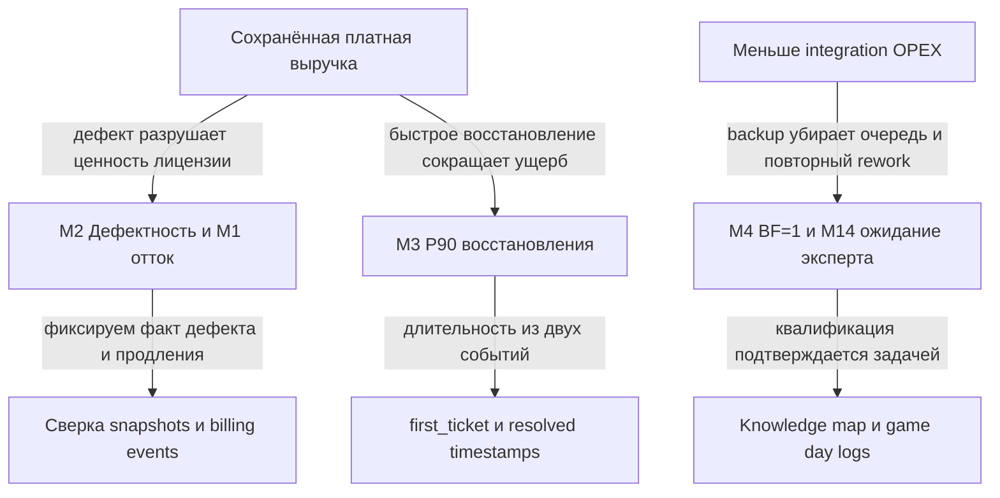

# Практическая работа №4 — Показатели, модель и бюджет

**Выполнил:** Харитонов Глеб Сергеевич  
**Курс:** Управление информационными технологиями на предприятии  
**Семестр:** осень/зима 2026  
**Дата:** 19.11.2026  
**Основание:** исправленная [ПР3](./practice_03_ati_su.md), гипотезы №1, №2, №3 из [ПР2](./practice_02_ati_su.md).

## Краткий паспорт проекта

1. **Бизнес:** ATI.SU, цифровая B2B-платформа автомобильных грузоперевозок; финансовый контур — ООО ИА «АВТОТРАНСИНФО».
2. **Масштаб:** база предыдущих работ — выручка 2025 года **1 475 795 000 ₽**; 1% = 14,758 млн ₽. База сохраняется для сопоставимости, не обновляется прогнозом.
3. **Монетизация:** лицензии, платные функции, «Площадки», API и аналитика; доли не раскрыты. Новые доходы от данных не входят в базовый бюджет ПР4.
4. **ИТ:** диагноз ПР1 «Партнёр», зона 🟡; процессы A — миграция и recovery, B — передача критических знаний. История №37/№55 сохраняется; новые назначенные лебеди **№3 и №5**.
5. **Ограничения:** только публичные материалы и игровой сценарий; внутренние замеры отсутствуют. Все численные ряды песочницы синтетические; доступ к реальным данным купленной биржи требует отдельного допуска.

## 1. Решение для руководства и связь с ПР3

Предлагается разрешить только этап инвентаризации и юридической подготовки с пределом **0,56 млн ₽**, входящим в общий бюджет. Полный запуск зависит от подтверждения оснований обработки, назначения владельцев, baseline и повторного финансового решения. Лебедь №5 блокирует сам перенос и чтение агентом, а №3 делает цену сохранённого контроля существенной: дополнительные десять недель стоят **13,846 млн ₽**.

| Гипотеза | Шаг ПР3 | Что проверяем в ПР4 | Какое решение следует |
|---|---|---|---|
| H1: безопасная миграция | сверка, human acceptance, gates, rollback, 7 дней наблюдения | дефектность, отток, принятый объём, цена приёмки | следующая волна или остановка |
| H3: recovery | подтверждение ущерба и стандартный пакет | удержание пострадавшей когорты, бюджет, fraud | продолжить пакет, изменить правила или остановить |
| H2: knowledge retention | Primary+Backup, runbook, game day, change gate | BF=1, ожидание эксперта, повторные затраты | допуск области либо запрет миграции |

Состояние игры на дату отчёта: владельцы систем и ответа регулятору ещё не назначены. Роли ниже — **проект назначения**, не утверждение о фактической оргструктуре ATI.SU. Лебеди №1, №2, №4, №6, №7 не назначены и не используются как случившиеся факты.

## 2. Дерево показателей

Смысл стрелок: нижний уровень даёт измерение верхнего, а подпись объясняет предполагаемую причинную связь. Это гипотезы механизма, не доказанные корреляции. Для полного дерева ограничения и затраты добавлены таблицей:

| Цифра бизнеса | Показатель процесса | Сигнал системы | Подпись связи |
|---|---|---|---|
| Сохранённая маржа | M7 критические ошибки, M8 fraud | reconciliation, security cases | исправленная скорость бесполезна, если пропадают рейтинги или грузы |
| Допустимый доход и отсутствие остановки обработки | M6 юридический допуск | версия legal register и access policy | недопустимая обработка блокирует процесс независимо от результата сверки |
| Экономия конкретной статьи | M9 integration OPEX, M5 успешный backup | time log, invoices, game day | меньше повторных исправлений и аварийных подрядчиков снижает выбранную статью |
| Финансовая жизнеспособность | M10 EAC, M11 цена приёмки, M13 принятый объём | счета, трудозатраты, release acceptance | затраты оплачиваются за все попытки, эффект только за принятый результат |
| Достоверность решений | M12 полнота наблюдений | schema audit, сопоставление billing IDs | потерянные записи могут создать ложное улучшение, поэтому неполные данные блокируют вывод |

## 3. KPI и OKR с защитой от натягивания

Все цели ниже — проектные пороги, утверждение комитетом ещё требуется. Срок OKR — 16 недель подготовки и пилота плюс до 30 дней наблюдения последней платной когорты. H2 финансово перепроверяется через 6 месяцев, как в ПР2.

| Тип | Показатель и цель | Как натянуть | Защита и решение |
|---|---|---|---|
| KPI | M6 = 100% операций с подтверждённым допуском | считать выданный доступ доказательством права | подписанное основание отдельно по операции, оператору, полям и цели; нет записи — stop |
| KPI | M7 = 0 критических расхождений при активации | назвать потерянный рейтинг некритичной ошибкой | неизменяемый каталог критичных полей, выборочная проверка Data Owner |
| KPI | M8 = 0 подтверждённых новых fraud-кейсов, связанных с переносом | не закрывать подозрительные обращения | учитывать открытые Sev1 отдельно; первая подтверждённая атака приостанавливает волну |
| KPI | M3 P90 ≤ 24 ч; rollback ≤ 2 ч по change record | закрывать и переоткрывать тикеты | связь всех повторов с исходным кейсом, часы от первого обращения |
| KPI | M10 полный pilot EAC ≤ 26,67 млн ₽; M11 ≤ 80 тыс. ₽/волну | убрать труд сотрудников и уже понесённые расходы | loaded hours, все прогоны и накопленный факт; 80 тыс. — cap 58,33 тыс. + 37% резерва |
| KPI | M12 ≥ 95% полных наблюдений | исключать проблемные и нестыкуемые ID | знаменатель фиксируется до обработки, исключения публикуются по причинам |
| OKR H1 | M1 снизить с оценочных 10% до ≤7%, M2 с 20% до ≤14% | взять только простых клиентов | рандомизация сопоставимых платных компаний, анализ intent-to-treat и ИП отдельно |
| OKR H3 | отток пострадавшей когорты на 40% ниже контроля, без превышения cap | дать пакет тем, кто и так продлил | случайное назначение пакета, обязательное восстановление получают обе группы |
| OKR H2 | M4 = 0 из 6 критических областей, M5 = 100%, M14 P90 ≤8 ч | назначить backup на бумаге | game day без primary, одинаковая задача и независимый наблюдатель |
| OKR H2 | M9 снизить статью 40 млн ₽ на 5% = 2 млн ₽/год | перенести расходы в соседний cost centre | неизменный состав статьи и контроль Finance, учёт новых постоянных затрат отдельно |
| OKR H1 | M13 = 30 000 принятых технических профилей за 6 волн | считать запущенные и повторные профили | unique profile_id, gates, 7 дней наблюдения; это не обещание перенести всю купленную базу |

Провал OKR ведёт к пересмотру гипотезы, а не к наказанию за честный результат. Нарушение KPI безопасности останавливает запуск даже при выполненном OKR.

## 4. Паспорта метрик

Общие правила: время UTC в журналах, отчёт Europe/Moscow; когорты фиксируются до запуска; повторные обращения объединяются; финансовые итоги в ₽ без НДС для модели, фактический режим подтверждает Finance. P90 считается по nearest rank `sorted[ceil(0,9×n)−1]`, при n=0 — N/A. Открытые кейсы показываются отдельным числом и возрастом: исключать их из хвоста без пометки нельзя. ИП/юрлица, платные/бесплатные, старая/новая платформа и волна — обязательные разрезы.

| ID, название и единица | Формула и отбор | Точка съёма и владелец | Частота и задержка | Цель и основание | Что искажает |
|---|---|---|---|---|---|
| M1 Отток платной когорты, % | не продлившие к D30 / все платные компании, включённые с оплатой к D0; один economic_id, ожидающие идентификации остаются в знаменателе | billing двух операторов + cohort register; Billing Analytics | ежедневно, T+1; окончательно D30+2 | ≤7% против оценки 10%, порог H1 = −30%; H3 отдельно −40% к своему контролю | цикл лицензии, сезонность, неполные ID, цены, отложенные оплаты |
| M2 Дефектные профили, % | unique профили с подтверждённым существенным дефектом за D0–D30 / все профили волны; даже исправленные остаются в числителе | source/target diff + incident register; Data Engineering Owner | по прогону и ежедневно, ≤1 ч для gate | ≤14% против оценки 20%, уменьшение 30%; критические отдельно M7 | неполный эталон, смена классификации, ложные флаги агента |
| M3 Восстановление, ч | P50/P90 `(resolved_ts − first_ticket_ts)` по объединённым migration cases; отдельно n открытых и oldest age | support/incident tracker; Head of Support | ежедневно, ≤1 ч | P90 ≤24 ч, учебный ожидаемый 18 ч, цикл одного дня | закрытие без результата, повторное открытие, правое цензурирование |
| M4 Области с BF=1, шт. | count утверждённых critical domains с <2 независимо проверенных квалифицированных специалистов | knowledge map + game day; Domain Leads | ежедневно в пилоте, T+1 | 0 перед миграцией затронутой области, из H2 и change gate | бумажный backup, исчезнувший из списка домен, устаревший навык |
| M5 Подтверждённый backup, % | области с успешной задачей backup без primary / все 6 утверждённых critical domains | game day evidence; Integration Lead | еженедельно, ≤1 рабочий день | 100% до полного допуска, практический критерий ПР3 | лёгкая задача, помощь primary, отбор только удобных областей |
| M6 Полнота юридического допуска, % | пары «операция × набор × оператор × цель» с актуальным заключением и подтверждёнными мерами / все такие пары в inventory | legal register + access audit; ответственный за ПДн, Legal руководитель | при изменении и ежедневно, до выдачи доступа | 100%, требование лебедя №5; любой неизвестный элемент — закрыт | неверный знаменатель inventory, истёкшее заключение, смена цели |
| M7 Критические дефекты при допуске, шт. | count несовпадений обязательных полей identity, рейтинга, истории и оплаченных прав, не закрытых до активации; на всю волну | immutable reconciliation report; Data Owner | до/после активации, ≤15 мин | 0, защита ценности клиента после №37 | неполный эталон, удаление полей из критичного списка |
| M8 Подтверждённые fraud-кейсы, шт. | distinct security case_id с подтверждённой связью с переносом/восстановлением; открытые Sev1 выводятся рядом | security tracker + client incidents; Security/Fraud Lead | немедленно, ≤1 ч | 0 новых подтверждённых, stop при первом; из цены повторения ущерба | запоздалая квалификация, скрытые случаи, отнесение к другой причине |
| M9 Integration cost pool, ₽/год | 12× сопоставимые месячные трудозатраты + внешняя помощь, тот же перечень cost centres; разовые улучшения отдельно | time tracking + finance ledger; Finance Controller | ежемесячно, T+10 | ≤38 млн ₽/год против оценки 40 млн ₽; H2 −5% | аллокации, загрузка команд, сезонный rework, перенос затрат |
| M10 Оценка затрат до завершения EAC, ₽ | понесённые расходы + обязательства + оставшиеся работы + оба контура до даты закрытия; полная и incremental версии раздельно | invoices, commitments, ресурсный план; CFO/PMO | еженедельно, T+2 | full ≤26,67 млн ₽, incremental ≤18,36 млн ₽ для ожидаемого сценария | изменение срока, double count лицензий, sunk cost, неполный штат |
| M11 Приёмка результата волны, ₽/принятую волну | все human review hours×loaded rate + agent/run, включая отклонённые попытки / число полностью принятых волн | time log, agent billing, change acceptance; Migration Lead + Finance | на волну, T+1 | ≤80 тыс. ₽; расчётное 58 333 ₽; при 0 принятых — N/A и все расходы отдельно | считать лишь успешный прогон, не учитывать sample и overtime |
| M12 Полнота данных наблюдения, % | записи когорты с economic_id, wave_id, оплатой и нужными timestamps / все записи когорты; число причин пропуска отдельно | schema/lineage audit; Data Analytics Owner | ежедневно, T+1 | ≥95% до статистического вывода; ниже — не объявлять успех | пропуски неслучайны, время миграции вместо времени ошибки |
| M13 Принятый объём, профили | count unique профилей, прошедших оба gate и 7 дней наблюдения; rejected и rolled back отдельно | migration registry; Integration Lead | ежедневно, ≤1 ч | 30 000 за 6 волн, предел ПР3; не число платных клиентов | дубли, смешение компаний и профилей, незрелые когорты |
| M14 Ожидание эксперта, ч | P50/P90 `(expert_first_response − task_created)` по critical tasks, с открытыми задачами и oldest age | issue tracker; Integration PMO | ежедневно, T+1 | P90 ≤8 ч против учебных 56 ч; слот следующего рабочего дня | формальный ответ без помощи, маршрутизация в другой трекер |

**Контроль происхождения времени.** `migration_complete` не равен `first_error`. Если момент ошибки неизвестен, время обнаружения не рассчитывается. Аналитик хранит оба поля и флаг отсутствия. Доступность и правомерность выгрузки проверяются до чтения; в отчёт банкам идут агрегаты, а не исходные персональные данные.

## 5. Экран руководства на одну минуту

**Срез 19.11.2026: учебный макет, не live-данные.** 🟢 — выполненный проектный контроль; 🟡 — условная оценка/нужна проверка; 🔴 — реальный блокер по сценарию. N/A выводится серым, не зелёным нулём.

| Состояние | Что видит руководство | Решение и ответственный | Срок |
|---|---|---|---|
| 🔴 | №5: основание переноса и чтения агентом не подтверждено; M6 неизвестен | CEO назначает ответственного за ПДн и руководителя ответа регулятору; Legal + Security закрывают доступ | назначение ≤2 рабочих дней, план ответа ≤5; фактический срок ответа берётся из запроса регулятора |
| 🔴 | №3: нет владельцев систем; EAC full 26,67 млн ₽ — только расчёт | CIO назначает владельцев legacy/target и FinOps; CFO согласует этап 0,56 млн ₽ | до решения о первой волне |
| 🟡 | H1: модель 10% →7%, не наблюдение; ожидаемый incremental payback 20,0 мес | Product Analytics проводит baseline и фиксирует контроль; комитет сравнивает со сроком ≤24 мес | до финального бюджета |
| 🟡 | Контроль занимает 12 технических недель; три крупные волны экономят 8,31 млн ₽, риск не оценён | комитет сохраняет 7 дней и размер 5 000 до проверки; дату полного переноса пока не обещает | решение после gate |
| 🟢 | Есть воспроизводимая арифметика и отдельная предварительная запись прогноза | студент сохраняет версию; аналитик готовит проверку фактом | до начала прогнозного периода |

**Две ключевые метрики с распределением** — числа из [учебного CSV](./pr4_synthetic_distributions.csv), по 10 случаев на сценарий. Это демонстрация экрана, не реальные SLA.

| Метрика | Сценарий | Среднее | P50 | P90 | Максимум | n |
|---|---|---:|---:|---:|---:|---:|
| M3, восстановление, ч | без изменения | 22,8 | 12 | 48 | 72 | 10 |
| M3 | ожидаемый | 8,8 | 6 | 18 | 24 | 10 |
| M3 | пессимистичный | 32,0 | 18 | 72 | 96 | 10 |
| M14, ожидание эксперта, ч | без изменения | 27,4 | 16 | 56 | 80 | 10 |
| M14 | ожидаемый | 4,25 | 3 | 8 | 12 | 10 |
| M14 | пессимистичный | 39,2 | 24 | 80 | 120 | 10 |

### Что теряется при свёртке

| Свёртка | Что скрывает | Как восстановить контекст |
|---|---|---|
| Среднее M3 = 22,8 ч | хвост до 72 ч, типичный случай 12 ч | P50/P90/max, число открытых, отдельный разрез ИП |
| P90 | последние 10%, возраст незакрытых кейсов и причины | max, oldest open, перечень Sev1, n и completeness |
| Зелёный общий churn | ухудшение одного тарифа или ИП при улучшении крупных клиентов | сегментные значения и доверительные интервалы |
| Одно число EAC | долю обязательных и отменяемых расходов, временную последовательность | разовые/постоянные/parallel, fact/commitment/forecast |
| Цвет юридического допуска | неподтверждённый отдельный набор или новую цель | раскрытие реестра пар «набор × операция × цель»; неизвестное блокирует зелёный |
| Итоговая «синергия» | смешение выручки, маржи, cash и разных баз процентов | раздельные строки P&L, gross/net, год 1 и steady state |

Перцентили выбраны по методике [Google SRE, Monitoring](https://sre.google/workbook/monitoring/): среднее не показывает долю медленных случаев. Источник обосновывает способ наблюдения, не численные цели ATI.SU.

## 6. Модель песочницы

Вопрос: **может ли уменьшение дефектов и зависимости от эксперта оплатить дополнительные проверки и параллельные системы?**

Файлы: [код](./pr4_model.py), [результат JSON](./pr4_model_results.json), [сценарии CSV](./pr4_scenario_results.csv), [учебные периоды](./pr4_synthetic_periods.csv), [распределения](./pr4_synthetic_distributions.csv). Запуск из каталога проекта: `python pr4_model.py`; проверка инвариантов: `python pr4_model.py --check`. Дополнительные пакеты не нужны. Реальные идентификаторы не используются.

### 6.1. Формулы и единицы

`R = 1 475 795 000 ₽/год; ARPAref = R / 100 000 = 14 757,95 ₽/год`.

100 тыс. — исторический публичный reference из ПР2, не число платных пользователей 2026 года. `Nref = (R/3)/ARPAref = 33 333,33` — экономическая оценка, не реестр клиентов.

`Npilot = 6 × 5 000 × 60% = 18 000 платных эквивалентов`.

`churn0 = defect0 × P(уход|дефект) = 20% × 50% = 10%`.

`H1 = Npilot × (churn0 − churn1) × ARPAref`.

`H3 = Nref ×25% пострадавших ×20% риска ухода × relative recovery reduction × ARPAref`.

`Retained revenue = H1 + H3 −20%×H3`; 20% — резерв до доказательства непересечения когорт. Если ledger подтвердит, что когорты различны, пересчитывается без резерва, но не до получения evidence.

`H2 = 40 млн ₽ × rate saving`. Длительности M3/M14 помогают объяснить механизм и план ёмкости, но не превращаются в деньги ещё раз: иначе та же потеря была бы монетизирована дважды.

`Contribution/year = Retained revenue ×80% + H2 − incremental recurring OPEX`.

Оценка 80% — маржинальность сохранённой выручки до новых расходов. Это **не факт** о рентабельности ATI.SU. Платёж D30 используется как leading outcome; годовой ARPA даёт годовой run-rate, а не деньги, полученные в первый месяц.

### 6.2. Сверка периодов и её предел

**Фактическая сверка с историей ATI.SU не выполнена:** в проекте нет обезличенных выгрузок billing/support/time tracking. Утверждать выполнение этого требования на «Х/П» было бы неверно. Ни синтетический CSV, ни публичный чужой инцидент не заменяют историю компании.

Проверка процедуры на двух **синтетических** непересекающихся периодах:

| Период | Назначение | N | Дефектные | Уходы в учебных данных | Прогноз | Ошибка |
|---|---|---:|---:|---:|---:|---:|
| 01–14.09.2026 | настройка `k =100/200 =0,5` | 1 000 | 200 | 100 | 100 | 0, только fitting |
| 15–28.09.2026 | holdout, k не меняется | 1 200 | 216 | 118 | 108 | −10 клиентов, **−0,833 п.п.**, APE **8,47%** |

Критерий допуска реальной модели: абсолютная ошибка оттока ≤1 п.п. и APE ≤15% на независимом периоде; это **проектные пороги**, а не достигнутая точность модели ATI.SU. Для редкого события с фактом 0 APE не рассчитывается, остаётся абсолютная ошибка.

План реальной сверки: Analytics берёт две последовательные завершённые когорты **до изменения процесса**, каждая с D30 и известной дефектностью; первый период для настройки, второй для проверки, без повторной настройки по holdout. Перед запуском даты, контрольные суммы и отбор вносятся в протокол. Если данных недостаточно, требуется дополнительный период, бюджет production не открывается. [План baseline](./pr3_baseline_measurement_plan.csv) содержит владельцев и правила пропусков.

### 6.3. Три сценария

| Параметр / результат | Без изменения | Ожидаемый | Пессимистичный |
|---|---:|---:|---:|
| Дефектность | 20% | 14% | 18% |
| Отток D30 при одинаковом составе | 10% | 7% | 9% |
| Относительное снижение churn H3 | 0 | 40% | 10% |
| Снижение статьи H2 | 0 | 5% | 2% |
| Legal подготовка, недель | 4 | 4 | 12 |
| Техническая часть, недель | 2 | 12 | 18 |
| H1, млн ₽/год | 0 | 7,969 | 2,656 |
| H3 самостоятельно, млн ₽/год | 0 | 9,839 | 2,460 |
| H1+H3 после пересечения, млн ₽/год | 0 | 15,840 | 4,624 |
| H2, млн ₽/год | 0 | 2,000 | 0,800 |
| Вклад после новых recurring расходов, млн ₽/год | 0 | 13,544 | 2,699 |

«Без изменения» — **сравнительный счётный вариант**, а не разрешение повторить массовую миграцию. Он предполагает тот же legal gate и условные 2 технические недели, без новых улучшений. Право на обработку нельзя отменить выбором сценария.

Пессимистичный сценарий запускается, если за четыре недели не готов правомерный периметр, согласование растягивается до 12 недель и сложность исправлений удлиняет техническую часть до 18 недель. Приёмка дорожает вдвое из-за дополнительных ручных проверок. Это стресс-сценарий **возможного будущего**, не утверждение о назначенном лебеде №2. Реальные правила остановки должны прекратить расходование раньше полного пессимистичного бюджета.

### 6.4. Прогноз до наблюдения

Отдельный [датированный прогноз](./pr4_forecast_2026-11-19.md) создан **19.11.2026** на когорту **21.12.2026–20.01.2027**: ожидается 210 непродлений из 3 000 платных эквивалентов против 300 без изменения, P90 восстановления 18 ч, ожидания эксперта 8 ч. При отсутствии допуска — 0 профилей в новом переносе, пользовательские метрики N/A. Прогноз условен, реальная когорта ещё не запущена. Для независимого подтверждения даты нужен коммит/передача преподавателю до начала периода; публикация не имитируется.

## 7. Бюджет и окупаемость

Все цены — оценка ресурсов, не коммерческие предложения и не реальный утверждённый бюджет. Ставка 2 000 ₽/ч обоснована в дополнении к реестру ПР3. Расходы команды считаются по loaded cost, даже когда это внутренний труд.

### 7.1. Разовые и переменные расходы ожидаемого сценария

| Статья | Расчёт | млн ₽ |
|---|---|---:|
| Pipeline и instrumentation | 240 ч ×2 000 | 0,480 |
| Legal inventory и доступ | 160 ч ×2 000 | 0,320 |
| Сверка billing и controls | 80 ч ×2 000 | 0,160 |
| Обучение и проектирование change | 80 ч ×2 000 | 0,160 |
| Передача знаний и приёмка 6 runbook | 6×134 тыс. | 0,804 |
| Game day | 6×2 ч ×2 000 | 0,024 |
| **Разовая подготовка C0** | **сумма предыдущих строк** | **1,948** |
| Агент и human acceptance | 6×58 333,33 | 0,350 |
| Лимит recovery, консервативно целиком | 0,15%×R | 2,214 |
| **Всего вне parallel** | **C0 + приёмка + recovery** | **4,512** |

Первые **0,56 млн ₽**: legal 0,32 + billing inventory 0,16 + первые 40 ч change design 0,08. Они **включены**, а не добавлены к C0. Пакет выполним лишь в разрешённом контуре старого оператора/по имеющимся основаниям; при их отсутствии работа ограничена описанием схем и синтетикой.

### 7.2. Постоянные расходы после запуска

| Статья | Расчёт | млн ₽/год |
|---|---|---:|
| Поддержка pipeline, мониторинга и моделей | 25 ч/месяц ×2 000 ×12 | 0,600 |
| Поддержание знаний | 6 областей ×2 ч/месяц ×2 000 ×12 | 0,288 |
| Security/legal пересмотр доступа | 10 ч/месяц ×2 000 ×12 | 0,240 |
| **Всего новых recurring** | | **1,128** |

Это дополнительные расходы. 6 млн ₽/месяц на два контура считаются отдельно, и они не скрыты в поддержке 0,6 млн ₽.

### 7.3. Цена двух контуров

`6 млн ×12/52 = 1,384615 млн ₽/неделю`.

| Вариант | Всего недель | Полное содержание двух контуров, млн ₽ | Дополнительные к сравнительному варианту, млн ₽ |
|---|---:|---:|---:|
| Сравнительный: 4 legal +2 technical | 6 | 8,308 | 0 |
| Ожидаемый: 4 legal +12 technical | 16 | 22,154 | **13,846** |
| Три крупные волны: 4+6 | 10 | 13,846 | 5,538 |
| Пессимистичный: 12+18 | 30 | 41,538 | **22,154** к варианту 12+2 с тем же legal delay |

Ожидаемые 16 недель описывают только пилотный объём. Закрытие всей legacy-платформы и прекращение 6 млн ₽/месяц — **сильное допущение бюджета**, возможное лишь при подтверждении, что оставшийся периметр не требует полного контура. Если контур продолжает работать после пилота, модель должна продлить расходы; объявлять окончание всей миграции по 30 тыс. профилей нельзя. Один лишний месяц добавляет **6 млн ₽** и примерно **5,3 месяца** к ожидаемой incremental окупаемости.

Для отчёта банкам при условном старте подготовки 19.11.2026 контрольная дата 16 недель — **11.03.2027**, только для приёмки пилотного объёма. Окончательная дата полного переноса появится после inventory и подтверждения остаточного периметра. Контрольные даты и их условия пересматриваются комитетом до обещания следующего транша.

Пропускная способность приёмки: 400 флагов ×3 минуты =20 ч плюс 4,17 ч sample на волну. Цель «ожидание ≤4 ч» не означает проверку всех 400 флагов одним человеком за четыре часа. Планируется пять последовательных подач по 1 000 профилей, по 80 флагов и до 4 ч их разбора каждая; следующая подача не открывается при незакрытом backlog. Предварительная сверка входит в подготовку волны, семидневное наблюдение после последней активации сохраняется. Если фактическая ёмкость не помещает подготовку, активацию и наблюдение в две недели, M10/M13 пересчитываются, размер волны не увеличивается автоматически. Это проект потока, не наблюдение о текущем числе аналитиков ATI.SU.

### 7.4. Финансовые результаты

| Показатель | Ожидаемый | Пессимистичный |
|---|---:|---:|
| Полный pilot cash envelope, млн ₽ | **26,666** | **47,374** |
| Incremental затраты к альтернативе с тем же legal delay, млн ₽ | **18,358** | **27,990** |
| Годовой вклад после новых OPEX, млн ₽ | **13,544** | **2,699** |
| Готовность для получения полного эффекта | 16 недель | 30 недель |
| Incremental окупаемость от начала, месяцев | **20,0** | расчётно 131,4, **за 24 месяца не окупается** |
| Возврат полного cash envelope, месяцев от начала | **27,3** | расчётно 217,5, **за 24 месяца не окупается** |
| Incremental результат первых 12 месяцев, млн ₽ | **−8,981** | **−26,848** |

Формула: `Tpayback = Tготовности + Cincremental / (annual contribution/12)`. До готовности эффект консервативно равен 0; после — равномерный. В расчёте полного cash возврата вместо incremental берётся full envelope. В год 1 учитываются только месяцы после готовности. Модель без дисконтирования, налогов, стоимости банковского финансирования и штрафов; эти величины неизвестны и не приняты равными доказанному нулю. Длинная пессимистичная экстраполяция показана как предупреждение о провале горизонта, не инвестиционный прогноз на 18 лет.

**Решение:** ожидаемый сценарий проходит только порог incremental ≤24 мес, полный cash не возвращается за этот срок; при требовании CFO вернуть весь cash за 24 месяца **полный пилот не утверждается**. При неопределённом сроке закрытия legacy и отсутствии исторической валидации открывается лишь этап 0,56 млн ₽. Это результат расчёта, а не искусственная подгонка под положительную синергию.

### 7.5. Критерии остановки

| Наблюдение | Действие | Кто решает |
|---|---|---|
| Нет основания переноса/чтения агентом или неподтверждённый оператор/цель | доступ и перенос закрыты до документированного решения; неизвестное не обходится обезличиванием «на глаз» | ответственный за ПДн + Legal; Security исполняет блокировку |
| К концу 4-й недели допуск не получен либо этап 0,56 млн ₽ исчерпан | остановить расширение затрат, пересчитать календарь и вынести отдельное решение | CFO + CEO |
| Не назначен владелец legacy, target или данных | не запускать волну и не отключать систему | CIO / председатель комитета |
| Критический дефект, новый подтверждённый fraud, BF=1 затронутой области | stop wave; локализация и rollback человеком по плану | Incident Lead, Security, Domain Lead |
| EAC превышает 26,67 млн ₽ или incremental payback >24 мес | не запускать следующую волну, пересмотреть объём; stop, если нет защищённого варианта | CFO + комитет |
| M11 >80 тыс. ₽/принятую волну два раза либо нет принятой волны | анализ очереди и правил, следующая волна закрыта | Integration Lead + Finance |
| Полнота наблюдений <95%, реальный holdout не проверен | не объявлять улучшение и не расширять пилот | Analytics Owner |
| Churn не снижается до порога после полного окна, CI не подтверждает пользу | завершить эксперимент как неуспешный/неопределённый; не масштабировать | Product Owner + Analytics |
| Recovery cap 2,214 млн ₽ исчерпан | новые дискреционные компенсации не обещать; обязательное устранение ущерба продолжается, отдельный эскалационный бюджет | Commercial + CFO + Legal |

## 8. Реестр новых допущений и источников

| ID | Число / предположение | Откуда оценка | Уверенность / критичность | Что снимет неопределённость |
|---|---|---|---|---|
| P4-1 | 6 млн ₽/месяц, 10 дополнительных недель | назначенный №3, текст условия | высокая для сценария / высокая | счета и границы duplicate run-cost |
| P4-2 | 4 legal недели, pess 12 | рабочие этапы inventory, основания, контроль доступа, ответ; срок регулятора не известен | низкая / критическая | юридический план и реальный запрос регулятора |
| P4-3 | 60% платных, 1 профиль =1 платный эквивалент | устраняет смешение 30 тыс. профилей и 33 тыс. клиентов, сценарий состава | низкая / критическая | billing/profile reconciliation |
| P4-4 | defect 20%→14%, P(churn|defect)=50% | разложение оценочного 10% ПР2 и снижение дефектности на 30% | низкая / критическая | baseline + контрольный тест, не только скорость |
| P4-5 | 80% маржинальности | сценарий вклада лицензии до дополнительных затрат | низкая / высокая | contribution margin Finance |
| P4-6 | 20% перекрытия H3 | консервативный reserve, пока нет benefit ledger | низкая / высокая | уникальные economic_id, когорта и причина выгоды |
| P4-7 | C0 1,948 млн, расходы §7 | оценка часов по работам ×2 000 ₽, game day отдельно | низкая / высокая | трудозатраты и подрядные предложения |
| P4-8 | recurring 1,128 млн/год | 25+12+10 ч/месяц ×2 000 | низкая / высокая | FinOps/time tracking |
| P4-9 | доход равномерно после готовности и сохраняется 24 мес | упрощение payback, сохранённые лицензии продолжают продлеваться | низкая / критическая | помесячный billing; sensitivities по сроку жизни |
| P4-10 | закрытие оплачиваемого parallel контура по окончании пилота | сильное условие для расчёта, ещё не подтверждено полным inventory | низкая / критическая | владелец legacy подписывает выход, остальные клиенты обслужены |
| P4-11 | синтетические часы, k=0,5, holdout 118 | учебные fixtures в коде и CSV; источник — автор модели | низкая как приближение / высокая | реальные независимые периоды |
| P4-12 | stop limits 95%, 80 тыс., 24 мес; error ≤1 п.п./15% | проектные уровни достаточности данных, резерва и бюджета, не публичные SLA | средняя / высокая | утверждение комитета до запуска |

Предыдущие допущения 100 тыс. paid reference, 40 млн ₽ cost pool, 8% флагов, 3 мин/флаг и recovery cap сохраняют основания из ПР2 и дополнения ПР3. Новый №5 означает, что одного утверждения об ограниченных правах агента уже недостаточно.

## 9. Источники и статус выполнения

1. [Паспорт проекта](./passport_ati_su.md), [ПР1](./practice_01_ati_su.md), [ПР2](./practice_02_ati_su.md), [ПР3](./practice_03_ati_su.md) — единая финансовая база и гипотезы, публичные ссылки находятся в исходных работах.
2. [Персональный эпизод №3/№5](./episode_02_swans_03_05.md), задания и разбор преподавателя — переданы в сообщении пользователя; нормативные условия курса, не новости о реальной компании.
3. [Google SRE Workbook, Monitoring](https://sre.google/workbook/monitoring/) — методика перцентилей и наблюдения, без заимствования численных целей.
4. [Kohavi, Tang, Xu, Trustworthy Online Controlled Experiments, Cambridge, 2020](https://www.cambridge.org/core/books/abs/trustworthy-online-controlled-experiments/introduction-and-motivation/B4A0C46514460B5A040DC45B7C3869B9) — причинная проверка контрольным экспериментом; применяется в ПР5.

Система показателей, паспорта, экран, воспроизводимая модель, три сценария, предварительная запись прогноза и бюджет подготовлены. **Открытый критерий — сверка с реальной историей ATI.SU**; также не подтверждены фактические baseline и юридический допуск. Работа честно оставляет эти ограничения, вместо вымышленных выгрузок или обещания оценки 5/5.
